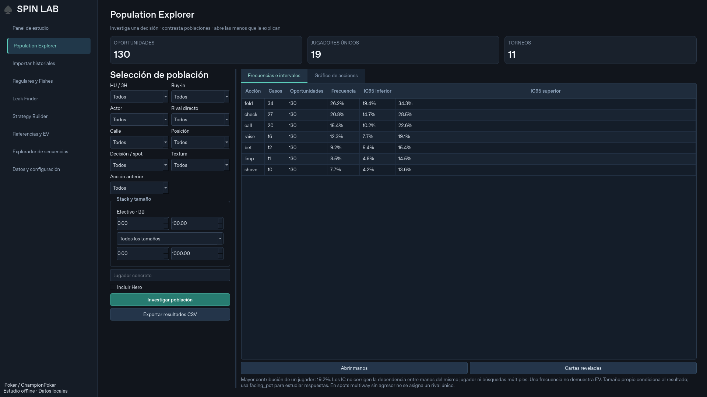

# Iteración 0.5 · SRP y escritorio

Continuación de `6a503ad` y `1f0c1bc`, sin reiniciar el proyecto. Se revisaron instrucciones, estado Git, motor y documentación; las 124 pruebas de partida pasaron. No se repitió investigación general de Hand2Note.

## Entregas funcionales

1. Motor de investigación SRP con 52 reportes nuevos: cbet, donk, probe, delayed cbet, stabs y barrels de turn/river, separando oportunidades bet/check de respuestas fold/call/raise. Se conservan los 27 reportes originales, las investigaciones guardadas y sus roles; total 79 reportes más constructor.
2. Desgloses condicionados por textura y tamaño enfrentado, con sus propios denominadores e IC. Se consultan en secuencias y la textura se puede filtrar visualmente.
3. Corrección de nueve apuestas all-in que abrían calle y estaban clasificadas como raises. Actualización a análisis 3 con backup verificado, progreso y rollback, manteniendo esquema 2.
4. Rediseño nativo PySide6 del Population Explorer: filtros laterales ajustables con scroll, tarjetas de oportunidades/jugadores/torneos, pestañas tabla/gráfico y acceso a manos/cartas. Tema oscuro común con jerarquía, foco y navegación lateral. Secuencias incorpora pestañas árbol/manos/desgloses. No se eliminan exportaciones, reglas, referencias, estrategias ni replayer.



## Validación

- Suite completa: **142 pruebas pasan**, incluidas las 124 anteriores. Se añaden 18 pruebas para líneas SRP, denominadores, all-ins, actualización de análisis, desgloses y fixtures reales. Se ampliaron las comprobaciones Qt de las vistas existentes.
- Verificador independiente SRP sobre originales de €5: **52 reportes, 17.315 oportunidades sumadas, cero omisiones, adiciones o resultados distintos**. La suma incluye nodos de una misma mano; no es una muestra de manos independientes.
- 36 historiales reales adicionales con nombres sustituidos se conservan como fixtures. Conciliación de aportaciones, saldos y premios comprobada. El fixture anterior y el nuevo se contrastan contra la máquina de estados, sin usar las etiquetas de spots para decidir las oportunidades esperadas.
- Tercer barrel limped HU: **196 oportunidades, 100 fold / 88 call / 8 raise**; sigue coincidiendo con su oráculo independiente.
- Comparación con backup: las nueve aperturas postflop mal etiquetadas pasan a bet; cero raises sin apuesta enfrentada restantes.
- La base mantiene **70.038 manos, 308.439 decisiones, 4.140 resúmenes y 14 errores**. Originales y backups locales fuera de Git. No se han generado etiquetas de población ni referencias ficticias.
- Interfaz renderizada a **1920×1080 y 2560×1440**, revisión visual del Explorer a 1920×1080 en Linux/offscreen. La suite navega todas las vistas en ambas resoluciones. Esto no verifica DPI ni instalación en Windows.

Comandos reproducibles:

```bash
QT_QPA_PLATFORM=offscreen python -m pytest -q
python -m scripts.validate_postflop --db RUTA --output INFORME_SRP.json
python -m scripts.validate_sequences --db RUTA --output INFORME_LIMPED.json
```

Las definiciones y límites estadísticos de SRP están en [POSTFLOP_SRP.md](POSTFLOP_SRP.md). Las frecuencias observadas no demuestran EV. Wilson sigue siendo exploratorio, sin corrección por dependencia entre manos/jugadores ni múltiples comparaciones. Las etiquetas son actuales y las cartas desconocidas siguen ocultas.

## Estado por fase

| Fase | Estado |
|---|---|
| 1 · Importación y motor | Núcleo y regresiones implementados; 14 headers ambiguos y contraste con replayer de sala pendientes. |
| 2 · Investigación avanzada | Barrels limped prioritarios y SRP con dos jugadores postflop implementados y contrastados; desgloses añadidos. Falta catálogo SRP multiway de tres jugadores, más líneas river stab/missed cbet y combinaciones avanzadas de tamaños. No se declara completa. |
| 3 · Interfaz | Explorer rediseñado y secuencias organizadas en pestañas. Pendiente modernizar en profundidad clasificación, referencias, Leak Finder y estrategias; validar DPI Windows. |
| 4 · Rangos/comparación | Comparación básica y cartas reveladas conservadas; matrices avanzadas y constructor completo de estadísticas pendientes. |
| 5 · Estrategia/leaks | Funciones anteriores conservadas. Ranking avanzado, incertidumbre agrupada y modelos EV de árboles pendientes. |
| 6 · Producto | Backup y migraciones probados. Faltan benchmark a millones, consultas generales asíncronas, Windows/instalador real y actualización distribuida. |

El próximo bloque de investigación debe cubrir SRP con tres jugadores postflop sin asignar un rival único ficticio. El próximo bloque de interfaz debe trasladar las consultas del Explorer general a un worker y continuar las vistas restantes. El build Windows está preparado, pero no se presenta como compilado o instalado en esta sesión.
