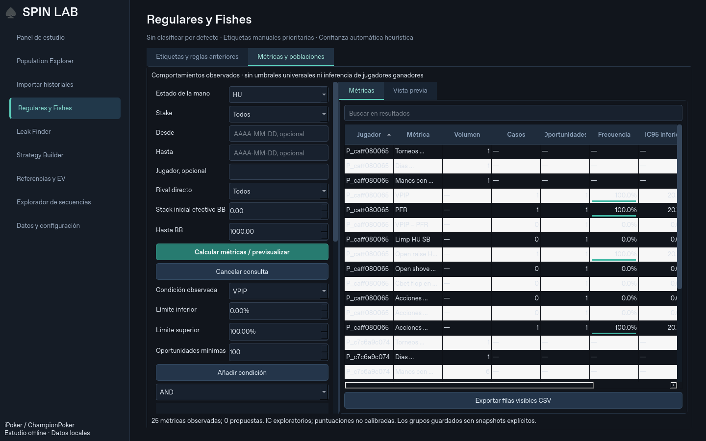

# Iteración 0.8 · primera fase del nuevo prompt maestro

## Auditoría y alcance

Se leyó íntegro el nuevo [MASTER_REQUEST.md](MASTER_REQUEST.md). Su orden de fases sustituye al anterior: primero clasificación/poblaciones; después rediseño integral con referencia 1440×900, constructor universal, Dual Mode/rangos, postflop, explotaciones y pulido. Esta entrega implementa un incremento funcional de la nueva Fase 1; no pretende completar el prompt entero.

Git estaba limpio en `8cf81b2`, coincidente con `main` remoto. Las **162 pruebas iniciales pasaron** antes de cambiar código.

Arquitectura revisada: `desktop.py` abre PySide6; `history.py` lee TXT; `engine.py` reconstruye fichas/decisiones; `context.py` añade contexto versionado; `Store` conserva originales, errores, etiquetas y documentos; los exploradores usan SQL agregado y workers. Se revisaron esquema, oportunidades, reglas VPIP/PFR, reportes, replayer y vistas. Se conserva todo ese flujo: **180 reportes, esquema 2 y análisis 3**. No se modifica el parser ni la reconstrucción.

Problemas priorizados: clasificador limitado a VPIP/PFR, ausencia de grupos sin etiquetas y tablas que crean una celda por dato. Persisten otros problemas de dashboard, navegación global, tablas antiguas y filtros: no se presentan como resueltos por esta entrega.

## Funciones entregadas

- Catálogo de **31 métricas/opciones observadas**: volumen/recurrencia, VPIP/PFR/diferencia, limp/open/iso/minraise/3bet/shove y métricas postflop de cbet, probe, barrels, folds, check-raise y proporción de decisiones agresivas por calle. Ver definiciones exactas y límites en [BEHAVIOR_METRICS.md](BEHAVIOR_METRICS.md).
- Contexto HU/3H, stake, fechas, stack inicial efectivo, jugador y rival directo. No se asigna un rival único ficticio al BTN first-in multiway.
- Motor de reglas AND/OR con evidencia desconocida diferenciada de cero. Puntuaciones configurables, conflictos y etiquetas manuales protegidas. El editor permite varias reglas con grupos AND u OR; los anidamientos más profundos se soportan en el motor, pendientes de editor visual completo.
- Vista previa sin escribir, evidencia por condición, aplicación transaccional y **deshacer con historial**. Se bloquea la aplicación si cambiaron datos/etiquetas desde el preview, y el rollback si hay cambios posteriores incompatibles. La interfaz permite deshacer la última aplicación de esta sesión; explorar revisiones antiguas por GUI sigue pendiente.
- Poblaciones personalizadas sin asignar Reg/Fish: definición/contexto/membresía/fecha persistentes. Recuperar, editar y refrescar explícitamente por nombre. Filtros de grupo actor y rival en Population Explorer y Sequence Explorer.
- Nueva pestaña **Regulares y Fishes → Métricas y poblaciones**. Consultas cancelables en worker; resultados en `QTableView`/modelo con búsqueda, ordenación, alineación, barras de frecuencia, columnas ajustables y exportación de filas visibles. No crea miles de widgets de celda. Las tablas antiguas siguen pendientes de conversión.

Se conservaron reglas simples, clasificaciones, referencias, modelo EV antiguo, estrategias, investigaciones, grupos por rol y replayer. No se añadieron solvers ni comparación teórica; no se trabajó en empaquetado.

## Verificación

**169 pruebas pasan** (162 anteriores y siete nuevas), más comprobación específica de la vista tras los ajustes de layout. Se incluyen denominadores, HU/3H, stack/Hero, rival no identificado, lógica AND/OR y ausencia de datos, conflictos, protección manual, grupos sin etiquetas, rollback por error, deshacer sin sobrescribir manuales posteriores y consulta/navegación Qt.

El verificador independiente `scripts/validate_behavior.py` recorre originales HU de €5 sin consultar etiquetas SQL de spots para construir sus resultados esperados. Compara por jugador seis frecuencias y tres contadores de volumen: **1.200 jugadores; cero discrepancias**. Entre los conteos verificados:

- VPIP: 18.625 / 30.088 manos con decisión preflop.
- PFR: 9.683 / 30.088.
- Limp HU SB: 6.572 / 15.392.
- Fold BB frente a minraise: 286 / 743.
- Fold frente a tercer barrel HU de todos los botes: 108 / 213; no se confunde con el spot prioritario limped de 196 oportunidades.

No se presenta esta comprobación como contraste independiente de cada variante de las 31 métricas. Se usan también fixtures reales existentes y escenarios sintéticos identificados en los tests.

La base real conserva **70.038 manos, 308.439 decisiones, 4.140 resúmenes y 14 errores**. No se escribieron grupos o etiquetas de prueba en la base personal. Se reutiliza `documents` para grupos, reglas y revisiones, sin migrar tablas ni requerir reimportación.

La vista se renderizó y probó a **1440×900, 1920×1080 y 2560×1440** en Linux/offscreen. La revisión a 1440 detectó y corrigió un scroll horizontal del editor y una colisión con un método virtual de Qt; se añadieron comprobaciones de geometría/pintado. El editor puede desplazarse verticalmente para acceder a todas las condiciones. Esto no verifica todavía DPI/interacción real de Windows.



```bash
QT_QPA_PLATFORM=offscreen python -m pytest -q
python -m scripts.validate_behavior --db RUTA --output INFORME.json
```

Se intentó consultar la documentación oficial específica de tipos de jugador de Hand2Note, pero el proxy respondió 403. No se atribuyen conclusiones a documentación externa no leída, ni se han inventado umbrales universales Reg/Fish.

## Cómo probar con Python

1. Cierra la aplicación y actualiza el código en la misma carpeta, conservando `.venv` y los datos; si utilizas Git, `git pull`.
2. Ejecuta **start_windows.bat**, igual que antes. No hay nuevas dependencias ni necesitas reinstalar Python.
3. Abre **Regulares y Fishes → Métricas y poblaciones**. Selecciona HU/3H, €5 u otro stake, fechas/stack si procede, y pulsa **Calcular métricas / previsualizar**.
4. Añade condiciones propias, elige AND/OR y categoría/subperfil/puntuación. Añade varias reglas al conjunto si lo necesitas. Vuelve a calcular y revisa **Vista previa**; doble clic en un jugador muestra la evidencia. No uses los intervalos iniciales amplios como una regla universal de clasificación.
5. Para investigar sin etiquetar, escribe un nombre y usa **Guardar población sin cambiar etiquetas**. Aparece como grupo de actor/rival en ambos exploradores. Se puede recuperar para editar y refrescar sus miembros.
6. Para clasificar, usa **Aplicar clasificación previsualizada**. Las manuales prevalecen; las automáticas del contexto pueden cambiar al reevaluarse. **Deshacer última aplicación de esta sesión** restaura el estado anterior si no hubo cambios incompatibles.

Comprueba especialmente scroll, legibilidad, ordenación y cancelación en Windows a 1440×900 y en tu DPI habitual. La base sigue en su ruta existente; no borres datos ni reimportes.

## Qué falta según las nuevas fases

| Fase del maestro | Pendiente |
|---|---|
| 1 · Clasificación/poblaciones | WTSD/WWSF/W$SD y otros denominadores de showdown bien definidos; más métricas de defensa BB; editor visual anidado; calibración externa, historial visual de revisiones y etiquetas históricas. La etiqueta sigue siendo global por jugador; el contexto filtra su evidencia. |
| 2 · Rediseño | Dashboard útil sin paneles vacíos, reorganización global, virtualización de tablas antiguas, más tooltips/estados y validación Windows/DPI. |
| 3 · Constructor | Ramas alternativas visuales, condiciones completas por nodo, Smart Reports y estadísticas personalizadas. |
| 4 · Dual/rangos | Comparación arbitraria sincronizada de escenarios y matrices/rangos observados avanzados. |
| 5 · Postflop | Continuaciones/sidepots pendientes del catálogo anterior, boards avanzados y tamaños configurables. |
| 6 · Explotaciones | Ranking empírico de diferencias, calculadoras transparentes y flujo completo hacia estrategias. No ampliar teoría/solvers. |
| 7 · Pulido | Caché, millones de manos, bloqueo/instancias en Windows, replayer/estudio y los 14 historiales ambiguos. |

No se declara ninguna fase íntegramente terminada. El próximo incremento debe continuar la Fase 1 (más métricas y edición multivariable) y preparar el dashboard/modelos reutilizables para la Fase 2. Las poblaciones son snapshots: una investigación guardada por nombre usará el snapshot vigente del grupo; fijar automáticamente su versión histórica sigue pendiente.

## Avances guardados

El núcleo de métricas/reglas/grupos y sus pruebas se guarda en `fb43d61`. La interfaz, integración con exploradores y actualización de documentación se guardan en el siguiente commit funcional de esta iteración (consultar `git log`).
